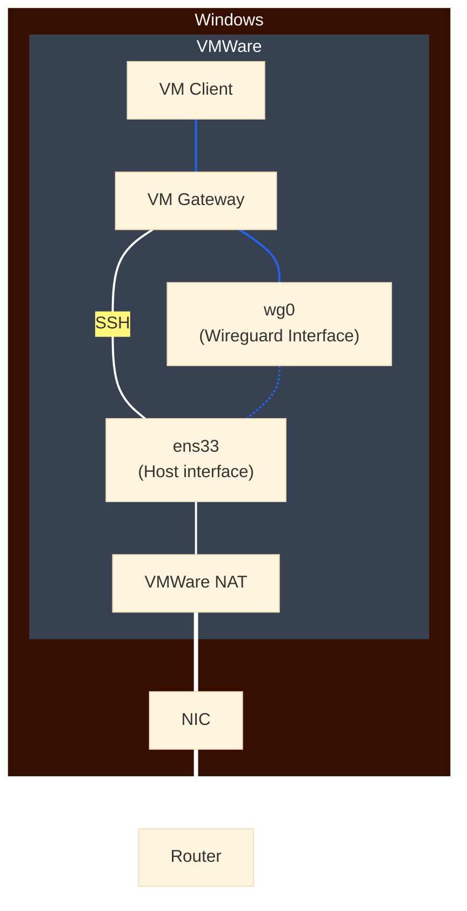

# Setting Up a Gateway Virtual Machine for VPN Connections
## 1. Routing Rules

Using the above diagram as a reference, we want to achieve a few things:
1. Use a VPN for all outgoing connections in the client VM without exposing credentials to it.
2. Be able to SSH to the VM controlling the VM networks.
3. Isolate client VM network from host OS while giving it access to the internet through VPN.
4. Have the gateway VM and the client VM be able to find each other at all times, undisturbed by DHCP.

We may do the following to achieve the above:
### 1. Gateway VM
As we want to be able to use the VPN **without** exposing its credentials to the client VM, we have one of two choices: use a gateway VM or use the host.

Mullvad does **not** have inverse split-tunneling, which makes it rather inconvenient to use on the host. Therefore, we use a gateway VM. We will use a lightweight, headless distribution of debian: `debian-13.7.0-amd64-netinst`. The following is the checklist for this step:
- [ ] Install `debian` & configure securely
- [ ] Install WireGuard `sudo apt install wireguard wireguard-tools`
- [ ] Generate a Mullvad WireGuard key from [here](https://mullvad.net/en/account/wireguard-config)
- [ ] Configure Mullvad account login

---

### 2. Network Interfaces & Static IPs
We want to achieve two things: let the gateway VM be discoverable by the client VM and prevent DHCP from possibly breaking the routing table. VMWare has a setting for custom network adapters. We will use `VMNet2`, but anything other than the `VMNet8 (NAT)` interface will work.
- [ ] Make sure ONLY VMNet2 is configured on the client VM
- [ ] Make sure BOTH VMNet2 and VMNet8 are configured on the gateway VM
- [ ] Edit /etc/network/interfaces on **gateway** VM to set `VMNet2` interface to a static IP.
    - We may use 10.10.10.0/24 here.
- [ ] Edit or create `/etc/netplan` yaml file in client VM to do the same if running Ubuntu. Else, follow the same step as the gateway VM.

- [ ] Ensure that DHCP still works for the main interface on the gateway VM.

We should be able to ping the gateway VM from the client VM now.
As an example, we will set the gateway VM to `10.10.10.1/24` and the client VM to `10.10.10.2/24` **in the context of `VMNet2`.
    - Make sure that the host interface (`VMNet8`) is unchanged.

Try `ping -c 4 10.10.10.1` from the client VM.

Below is an example `/etc/netplan/01-network-manager-all.yaml` file:
```bash
network:
  version: 2
  renderer: networkd
  ethernets:
    ens33:
      addresses:
        - 10.10.10.2/24
      routes:
        - to: default
          via: 10.10.10.1
      dhcp4: false
      nameservers:
        addresses:
          - 10.64.0.1

```

---

### 3. WireGuard Configuration on Gateway VM
We can find the WireGuard configuration file generator [here](https://mullvad.net/en/account/wireguard-config).
If not present in the generated file, add:
```
Table=off
AllowedIPs=0.0.0.0/0,::0/0
```
We turn off WireGuard's routing table as we will want to set up our own later on. \
The AllowedIPs field can be changed as needed.

- [ ] Edit or create `/etc/wireguard/wg0.conf`. The file name can be arbitrary.
- [ ] Paste the generated file from the WireGuard generator above, or create own file.
- [ ] Use `wg-quick up wg0` to register WireGuard's virtual interface.

---

### 4. Routing Rules & Tables
We must now set routing tables for connections destined for and originating from the client VM.
We will set up two rules:
1. Connections **from** the client VM must be routed through `wg0`.
2. Connections **to** the client VM must be routed through the `WMNet2` interface.

To accommodate for the first rule, we will have to create a routing table that defaults to `wg0`.

- [ ] Create a routing table 200 that defaults to `wg0` using `ip route add default dev wg0 table 200`.
    - If 200 is already in use, then choose any unused id from 1-252, or 256+.
- [ ] Create rule no. 1: `ip rule iif ens34 lookup 200 priority 1000`.
    - Replace `ens34` with the interface name of the virtual network adapter shared with the client VM.
- [ ] Create rule no. 2: `ip rule from 10.10.10.0/24 lookup main priority 999`
    - `10.10.10.0/24` can be narrowed down to just a single VM: `10.10.10.2`.
- [ ] Enable IPv4 forwarding using `sysctl -w net.ipv4.ip_forward=1`, then `sysctl --system` to apply.

**CHECK**:
- [ ] FROM the **client VM**, `ping -c 5 host_ip` does **NOT** work.
- [ ] IN the **gateway VM**, activate `tcpdump -nni wg0`.
- [ ] FROM the **client VM**, use `ping -c 5 1.1.1.1`.
- [ ] IN the **gateway VM**, check that ICMP requests are arriving from the client VM's IP destined for 1.1.1.1 through `tcpdump`.
    - Also check that the responses are returning (i.e. 1.1.1.1 > 10.10.10.2).

---

### 5. Routing Configuration Persistence on Gateway VM
Routing rules & tables are not persistent on debian and will be lost upon reboot. We can use the WireGuard configuration file to make it persistent. In `/etc/wireguard/wg0.conf`:

Note, `%i` is a placeholder for the selected WireGuard interface through `wg-quick`. In this case, it is `wg0`.
```
# FROM PART 3
Table=off
AllowedIPs=0.0.0.0/0,::0/0

# PERSISTENCE
PostUp = ip route replace default dev %i table 200
PostUp = ip rule add iif ens34 lookup 200 priority 1000
PostUp = ip rule add to 10.10.10.0/24 lookup main

PreDown = ip rule delete iif ens34 lookup 200 priority 1000
PreDown = ip rule delete to 10.10.10.0/24 lookup main
PreDown = ip route flush table 200
```

- [ ] Add the persistence section to `/etc/wireguard/wg0.conf`.
- [ ] Test using `wg-quick down wg0` and `ip rule show && ip route show table 200`.
- [ ] Test using `wg-quick up wg0`. Leave it up if no errors occur.

**PERSISTENCE FOR OTHER SERVICES**
- [ ] `systemctl enable wg-quick@wg0` to automatically activate WireGuard on boot.
- [ ] `systemctl enable nftables` to automatically enable nftables on boot.
- [ ] `sysctl -w net.ipv4.ip_forward=1` to persist IPv4 forwarding.

At this point, the setup should be complete.

**CHECK**:
- [ ] `curl https://am.i.mullvad.net/json | jq` from the **client VM**.
    - The following is an example of what should be received (I redacted the IP here ): 
    ```json
    {
        "ip": "[REDACTED]",
        "country": "Australia",
        "city": "Melbourne",
        "longitude": 115.861397,
        "latitude": -31.95224,
        "mullvad_exit_ip": true,
        "mullvad_exit_ip_hostname": "au-mel-wg-401",
        "mullvad_server_type": "WireGuard",
        "blacklisted": {
          "blacklisted": false,
          "results": []
        },
        "organization": "DataPacket"
    }     
      ```
- [ ] `tcpdump -nni esp33 'port 53'` from the **client VM**.
    - From another shell, use `nslookup google.com` or perform a query that would otherwise perform a DNS lookup.
    - The logs from `tcpdump` should reflect lookups to Mullvad's internal DNS server `10.64.0.1`.

---

### 6. SNAT (optional)
Mullvad applies SNAT to your packets, but for completeness this section will be included anyway.
We may use `nftables` to achieve SNAT between the client VM and the gateway VM:
```bash
table ip vpn_nat {
        chain postrouting {
                type nat hook postrouting priority srcnat; policy accept;
                oifname "wg0" ip saddr 10.10.10.0/24 masquerade
        }
}
```
A few explanations:
> `chain postrouting`
This means the packets will be processed **after** routing is decided.

> `type nat`
Processing of type NAT.

> `hook postrouting`
Processing done **after** routing and **before** packets leave the interface.

> `priority srcnat`
Standard source NAT priority (100).

> `policy accept`
Default policy is to accept packets.

> `oifname`
Only interface name. In this case, it's `wg0`.

> `ip saddr 10.10.10.0/24`
IP source address.

> `masquerade`
All source will now share wg0's interface IP address.

There are two ways to implement this:
> `nft 'add chain ip vpn_nat postrouting { type nat hook postrouting priority srcnat; policy accept; }'`
or
> Modify `/etc/nftables.conf` to include the above code block.

Note that it can only be persisted through the config file and enabling `nftables` through `systemctl`.

---

## List of Tools Used
1. `ip`
    - `ip -br addr` - Shows the IP addresses of all network interfaces on the VM.
    - `ip rule` - Shows all routing rules on the VM.
    - `ip route` - Shows the main routing table.
    - `ip route show table table_id` - Shows a particular routing table.
2. `ifupdown/networking` (Debian)
    - `/etc/network/interfaces` is handled by `ifupdown` on debian.
    - `ifdown [dev]` deconfigures an interface `[dev]`
    - `ifup [dev]` configures an interface `[dev]`.
3. `netplan` (Ubuntu)
    - Ubuntu uses `netplan` as its default network manager.
    - Configuration files available in `/etc/netplan/`.
    - `netplan get` `netplan apply` `netplan try`
4. `wg-quick`
    - `wg-quick up [inf]`
    - `wg-quick down [inf]`
5. `mullvad`
6. `nftables`
    - `/etc/nftables.conf`
    - `nft add rule`
    - `nft list ruleset` - Shows all active netfilter rules.